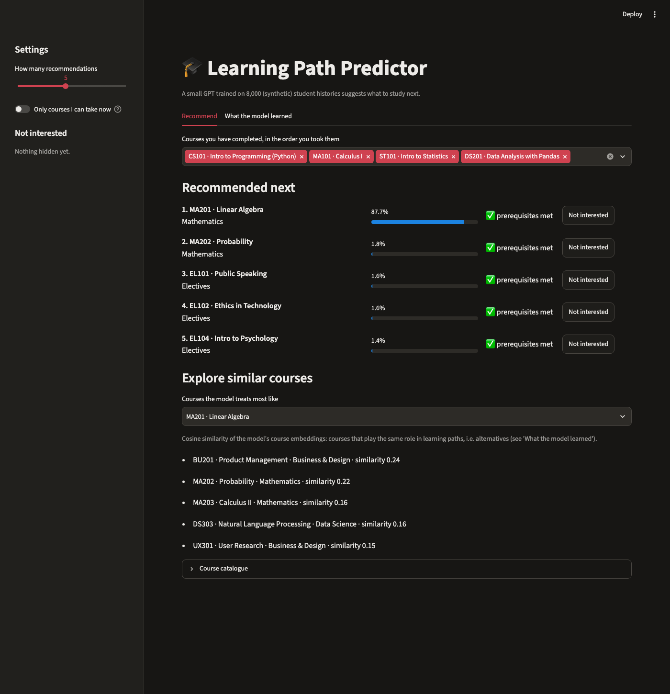
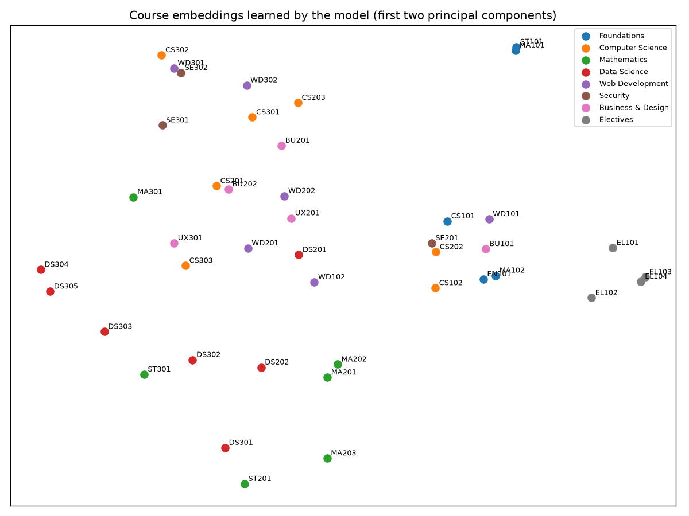
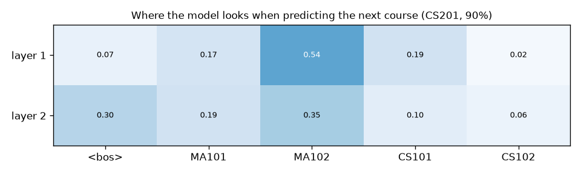

# Learning Path Predictor

[](../../actions/workflows/ci.yml)
[](https://ask.thili.ai/b/9nsnx7z2dn)

A student picks the courses they have completed, in order, and gets the most likely next courses with a
probability for each. Behind it is a **small GPT-style language model trained from scratch, in which every
course is one token**. A student's history is a sentence such as `<bos> CS101 MA101 ST101 DS201`, and
recommending a course is predicting the next word. It is the market-basket idea from the drill (teach a
language model what goes together), applied to ordered course histories.



## Results

**Next-course prediction** on 1,000 held-out students (5,636 predictions: each history is cut after every
course, and we check where the course the student really took next lands in each ranking). Full table:
[results/metrics.md](results/metrics.md).

| method | hits@1 | hits@3 | hits@5 | MRR | top-1 has prerequisites met |
|---|---|---|---|---|---|
| baseline: most popular courses | 0.183 | 0.344 | 0.486 | 0.328 | 100.0% |
| baseline: what followed the last course (Markov chain) | 0.524 | 0.774 | 0.836 | 0.670 | 89.4% |
| baseline: what followed any completed course (co-occurrence) | 0.438 | 0.611 | 0.777 | 0.563 | 86.0% |
| **CourseGPT (this project)** | **0.719** | **0.882** | **0.926** | **0.811** | **99.9%** |
| *reference: oracle told each student's planted path* | *0.799* | *0.837* | *0.855* | *0.831* | *100.0%* |

- The model's top pick is right 72% of the time, against 52% for the best counting baseline. The oracle
  is *told* which path each student follows and still only reaches 80%, because the data has noise (random
  electives, swaps, detours). So the model is close to the ceiling for this data.
- The gain comes from reading the **whole history**. After `WD101 → CS101` the model says JavaScript (98%),
  because a web student who started with HTML takes it next. After `CS101` alone it splits between Data
  Structures, Calculus and Statistics. Samples: [results/samples.md](results/samples.md).
- Nobody told the model about prerequisites, yet 99.9% of its top picks have them met (the baselines manage 86–89%).

**Training** ([results/training.json](results/training.json)): 104,576 parameters (2 layers, 4 heads, 64
dimensions), 30 epochs in about 30 seconds on a laptop CPU. Validation loss went from 3.84 to 1.19, a
perplexity of 3.3 over 43 courses.

**What the model learned** ([results/itemsets.md](results/itemsets.md)). The model wrote 8,000 student
histories of its own. The drill's exact Apriori miner (`thilimarketbasket.mine`) mined frequent itemsets
(2–4 courses, support ≥ 5%) from them and from the real training data:

| | model's histories | baseline: popularity-only histories |
|---|---|---|
| real itemsets reproduced (recall) | **98.7%** (522 of 529) | 18.5% |
| generated itemsets that are real (precision) | **80.8%** | 52.4% |
| correlation of itemset supports | **0.984** | 0.474 |

- **Planted bundles:** both are reproduced. DS301 → EL102 (Ethics in Technology) is followed 58% of the time
  in the model's histories, against 53% in the real data. BU201 → EL101 is 52% against 51%.
- **Planted paths:** the opening four courses of all 8 paths appear as often as in the real data, for
  example ML engineer 0.255 against 0.244.
- **Prerequisites:** 93.6% of the model's own histories put every course after its prerequisites.
- **Embeddings group courses by role, not by basket.** Entry courses sit together, electives sit together and
  advanced courses spread out by area (cosine similarity 0.15 within a track, -0.01 across tracks). Courses
  taken *together* are not similar. So the app's "similar courses" shows **alternatives**, and courses
  taken together come from the next-course prediction.
- **Attention follows prerequisites.** For `MA101 MA102 CS101 CS102` the model predicts CS201 (Algorithms, 90%)
  and attends most to MA102. That is the course that separates the theory path from the backend path, and it
  is a prerequisite of CS201.

<p float="left">
  
  
</p>

## Limits

- **The data is synthetic.** It has 43 made-up courses and 8 planted learning paths, plus noise
  ([app/data.py](app/data.py)). The point is that the right answer is known. Real enrolment data would be messier, with more
  courses, retakes and timing, and the numbers above say nothing about how it would do there.
- **New courses are unknown to the model.** It has one token per course, so adding a course to the catalogue
  means retraining (about 30 seconds here).
- **The model can repeat itself.** When it writes histories freely, 4.4% repeat a course. The app never
  shows this, because completed courses are always removed from recommendations.
- **Probabilities beyond the top pick are small.** After a clear path, for example CS101 → MA101 → ST101 →
  DS201, the top course gets about 88% and the rest about 2% each. They are the model's real probabilities,
  not a calibrated "match score".
- **"Not interested" only filters.** It removes a course from later lists. It does not retrain the model or
  change what the model believes.
- **Only one training run** is reported (seed 0). There are no error bars across seeds.

## Run it

You need Python 3.11 or 3.12 and git. The trained model (430 KB), the dataset and all results are in the repo,
so the app works right away without training.

```bash
python3 -m venv .venv && source .venv/bin/activate
pip install -r requirements.txt
make app              # or: streamlit run app/main.py  -> http://localhost:8501
```

No API key or hosted model is needed. A history can be shared as a link:
`http://localhost:8501/?completed=CS101,MA101,ST101`.

**Rebuild everything from scratch.** This runs dataset → training → evaluation → analysis in about 40 seconds
on a laptop CPU, and gives the same numbers as above:

```bash
make all
make test             # 37 tests; they train their own tiny model, so they run offline in about 3 s
```

**Or with Docker** (no Python needed):

```bash
docker build -t learning-path-predictor .
docker run --rm -p 8080:8080 learning-path-predictor     # -> http://localhost:8080
```

## How it works

| milestone | file | what it does |
|---|---|---|
| 1. mock data | [app/catalog.py](app/catalog.py), [app/data.py](app/data.py) | 43 courses with prerequisites and 8 planted paths that share their opening courses and split later. Each of 10,000 students follows one path, stops at a random point and adds noise. 80/10/10 split in [dataset/](dataset) |
| 2. pretrain an LM | [app/model.py](app/model.py) | Causal transformer written in PyTorch, one token per course, embeddings tied between input and output. AdamW, warm-up then cosine learning rate, padding-masked loss, keeps the best validation checkpoint |
| 3. predict next | [app/predict.py](app/predict.py) | `Recommender.predict_next(history, k, exclude)` removes completed and "not interested" courses and renormalises. Also the three baselines, the oracle and the evaluation |
| 4. Streamlit UI | [app/main.py](app/main.py) | Ordered course picker, top-N with probability bars, prerequisite check, "only courses I can take now" filter, **Not interested** (saved to `data/app.json`), **similar courses** by embedding, and a tab with the analysis |
| 5. learned itemsets | [app/analyze.py](app/analyze.py) | Sample histories from the model, mine them, compare with the real data and a popularity baseline, plus the embedding map and the attention plot |

Tests for each milestone are in [tests/](tests): `test_data.py`, `test_model.py`, `test_predict.py`,
`test_app.py` (drives the Streamlit app headlessly) and `test_analyze.py`.

Stretch ideas done: probability next to each recommendation, "not interested" feedback, and exploring similar
courses by embedding similarity.

## Milestones

- [x] **1. Generate mock student course completion data as sequences of course IDs.**
- [x] **2. Pretrain a small language model on these course ID sequences.**
- [x] **3. Implement a function to predict the next likely course given a partial sequence.**
- [x] **4. Create a Streamlit interface for students to input their completed courses and view recommendations.**
- [x] **5. Analyze which course "itemsets" the model has learned.**
