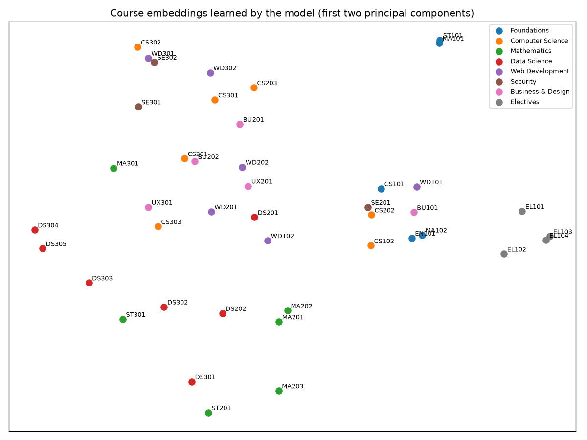
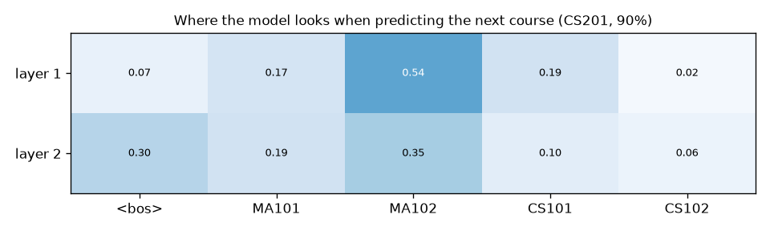

# What the model learned

8,000 histories written by the model vs the 8,000 real training histories. Frequent itemsets of 2-4 courses mined from each with the exact Apriori miner (`thilimarketbasket.mine`) at support ≥ 5%.

## Itemsets

The baseline column fills histories of the same lengths with courses drawn by popularity alone, so it shows what you get from popular courses with no learned structure.

| | model | baseline: popularity only |
|---|---|---|
| frequent itemsets in the real data | 529 | 529 |
| frequent itemsets in the generated histories | 646 | 187 |
| found in both | 522 | 98 |
| recall (real itemsets reproduced) | 98.7% | 18.5% |
| precision (generated itemsets that are real) | 80.8% | 52.4% |
| correlation of supports | 0.984 | 0.474 |
| mean absolute support error | 0.0137 | 0.0649 |

| size | real | model | both |
|---|---|---|---|
| 2 | 126 | 133 | 123 |
| 3 | 203 | 238 | 201 |
| 4 | 200 | 275 | 198 |

**Most frequent real itemsets and their support in the model's histories**

| itemset | real support | model support |
|---|---|---|
| CS101 + ST101 | 0.469 | 0.477 |
| CS101 + MA101 | 0.399 | 0.391 |
| CS101 + DS201 | 0.394 | 0.411 |
| DS201 + ST101 | 0.394 | 0.410 |
| CS101 + DS201 + ST101 | 0.394 | 0.410 |
| CS101 + CS102 | 0.360 | 0.366 |
| MA101 + ST101 | 0.342 | 0.327 |
| CS101 + CS202 | 0.309 | 0.333 |
| CS101 + MA101 + ST101 | 0.306 | 0.304 |
| MA101 + MA201 | 0.281 | 0.279 |
| CS101 + MA201 | 0.259 | 0.268 |
| CS101 + MA101 + MA201 | 0.259 | 0.268 |

## Planted structure

| planted bundle (taken right after) | planted rate | real data | model |
|---|---|---|---|
| DS301 → EL102 | 60% | 52.5% | 58.4% |
| BU201 → EL101 | 60% | 50.9% | 52.2% |

| planted path (first four courses together) | real support | model support |
|---|---|---|
| ml_engineer: CS101 MA101 ST101 DS201 | 0.244 | 0.255 |
| data_analyst: CS101 ST101 DS201 DS202 | 0.138 | 0.153 |
| backend: CS101 CS102 CS202 WD202 | 0.144 | 0.157 |
| full_stack: WD101 WD102 CS101 WD201 | 0.130 | 0.130 |
| security: CS101 CS102 MA102 SE201 | 0.082 | 0.078 |
| cs_theory: MA101 MA102 CS101 CS102 | 0.089 | 0.079 |
| product: BU101 EN101 WD101 UX201 | 0.067 | 0.065 |
| statistician: MA101 ST101 MA202 MA201 | 0.205 | 0.206 |

- Model-written histories in a valid prerequisite order: **93.6%** (courses taken before their prerequisites: 0.38%; histories repeating a course: 4.35%).
- Mean history length: real 6.62, model 6.82. Correlation of per-course frequency: 0.998.

## Embeddings

- Mean cosine similarity of course embeddings: same track 0.145, different track -0.013, neighbours on a planted path 0.082.
- Planted bundle DS301 + EL102: cosine -0.109, rank 34 of 42 among the first course's neighbours.
- Planted bundle BU201 + EL101: cosine 0.075, rank 16 of 42 among the first course's neighbours.

**Nearest neighbours (cosine) for a few courses:** CS101 → WD101, BU101, MA101; WD101 → MA101, BU101, CS101; DS301 → ST301, DS305, ST201; MA101 → WD101, BU101, CS102; BU201 → CS302, UX301, UX201

## Attention

## Reading the results

- **The itemsets live in the model's predictions.** Sampling histories from the model and mining them recovers almost every frequent itemset of the real data with close supports, including both planted bundles and the opening of every planted path. The extra itemsets the model invents are mostly 4-course sets just under the support threshold in the real data (the model is a little smoother).
- **Embeddings group courses by role, not by basket.** Courses with similar neighbours on either side (the entry courses CS101, WD101, BU101, MA101; the electives; the advanced courses of each area) point the same way. Two courses that are taken *together* (DS301 then EL102) are not similar: one is an advanced ML course, the other an elective taken at any time. So embedding similarity finds alternatives to a course; co-taken courses are found by asking the model what comes next.
- **Attention follows prerequisites.** In the example above, after MA101, MA102, CS101, CS102 the model predicts CS201 (Algorithms) and the strongest attention goes to MA102: the course that tells the theory path (CS102 → CS201) apart from the backend path (CS102 → CS202), and a prerequisite of CS201.
